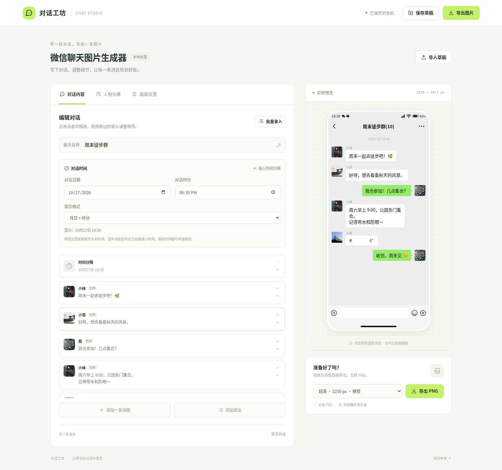
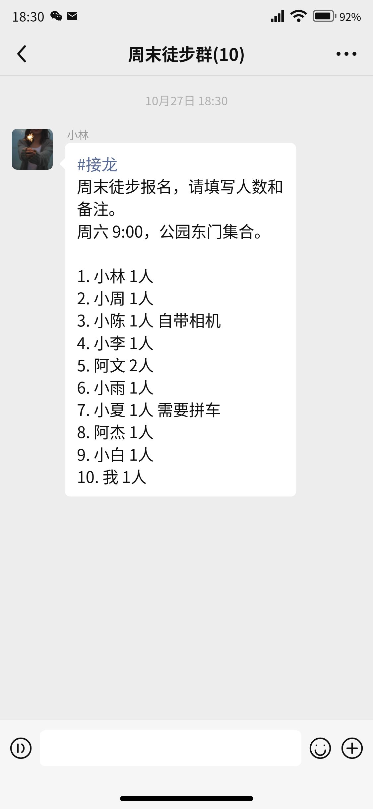

# 对话工坊

微信风格聊天图片编辑工具。纯 HTML / CSS / JavaScript，无构建依赖，数据保存在当前浏览器。

## 效果展示

以下截图使用虚构昵称和周末徒步内容，展示编辑器界面与实际导出的群聊接龙图片。

**编辑器界面**：编辑消息、设置时间，在右侧实时预览聊天效果。



**群聊接龙导出**：群名显示人数，接龙首行使用蓝灰色，正文保持普通黑色。



## 使用

克隆仓库后启动本地静态服务，无需安装前端依赖或配置 API Key：

```bash
git clone https://github.com/san-tian/wechat-chat-studio.git
cd wechat-chat-studio
python3 -m http.server 8765 --bind 127.0.0.1 --directory dist
```

打开 http://127.0.0.1:8765 。使用 HTTP 预览，确保内置照片能被图片导出器读取。头像压缩包中的 `index.html` 可以直接打开浏览。

- 编辑消息、上传头像和图片、添加群聊人物；支持文字、图片、语音外观、时间、系统提示、转账及红包外观。
- 点击“添加接龙”或选择“接龙消息”，可直接粘贴完整接龙，也可从说明和每行一条的名单生成连续编号。按参考截图，仅首行 `#接龙` 显示蓝灰色 `#576b95`，正文、数字、备注、链接字样及后续井号文字保持普通黑色；字号、行高和字重沿用普通消息，保留说明与名单之间的空行。旧草稿和粘贴内容中以 `#接龙` 起头的文字也可识别。
- 内置 400 张 512 × 512 的混合照片头像（人像、动物、风景、城市与生活），新增人物自动分配未用头像；群聊最多 400 人，支持按昵称清单批量添加。已用记录独立于当前聊天保存，删除人物不会回收头像，用尽时会停止分配。只有手动重置已用记录才允许再次使用。
- 人物头像页可分页选图、只看未用头像、整群换一批未用头像，以及下载 `dist/wechat-avatars-400.zip`。自定义上传的头像会保留。保存的 JSON 草稿携带已用记录，导入另一个浏览器时会合并，避免跨草稿重新分配。
- 批量录入支持 `名字：内容` 和 `[时间]`，多行文字可续接上一条消息。
- 对话内容上方可指定日期与时分，更新开头的时间分隔；也可在选中消息前插入新的时间分隔，并在消息编辑器中单独修改此段日期与时间。支持年月日、月日、时分、今天/昨天、星期及自定义文字，和顶部状态栏时钟分别设置。
- 时间分隔保存作者指定的日期及时分，不作时区转换。旧草稿中的自由文本会保留；批量输入 `[2026-10-27 18:30]` 后可继续用日期、时间控件编辑。
- 设置状态栏、气泡颜色和字号，选择手机画面或完整长图，导出 375 / 750 / 1125 / 2250 像素宽的无损 PNG。默认 2250 × 4872。
- 聊天标题使用半粗体。群聊模式会根据人物列表自动显示成员人数（包含本人），增删人物时同步更新；长群名省略时仍保留人数，旧草稿中手写的末尾人数会合并为实际人数。
- 状态栏默认采用安卓样式，可按勾选顺序显示微信、QQ、支付宝、抖音、邮件、音乐中的最多 4 个单色通知图标，也可切换至 iOS 样式。支持 Wi-Fi 开关与信号强弱、移动网络标识、双 SIM 卡信号以及电量百分比。Wi-Fi 采用填充式矢量图形，预览和高清 PNG 共用相同图形。
- 点击预览里的消息可选中编辑。使用 JSON 草稿在不同浏览器之间迁移。
- 预览与导出使用同一套 1125 像素宽的 HTML / CSS 原生排版。字体基线、中文标点、emoji 和换行交给浏览器排版，预览仅缩放 DOM。
- 文字气泡按浏览器排版后的最长一行收紧，去掉中文标点或 emoji 换行后多余的行末空间，保持原有行数。左右内边距默认为 12 逻辑像素，可在画面设置中调整为 8–18 像素；语音、转账和红包样式保持各自的内边距。
- 导出时在原生尺寸创建独立 DOM，通过本地 html-to-image 1.11.13 生成 SVG，再按目标分辨率光栅化为 PNG；不放大预览位图，不自动缩小超限长图。依赖及 MIT 许可证保存在 `dist/vendor/`，运行时无需访问 CDN。
- 所有上传图片经过本地解码和缩放（头像最高 512 像素，聊天图片最长边 2560 像素），内容无需后端服务。

## 参考及范围

参考 https://chat.laogao.xyz/?tool=chat 的公开渲染尺寸和配色：1125 × 2436、背景 `#ededed`、右侧气泡 `#95ec69`、头像 123 像素、文字 48 像素。聊天渲染代码独立实现，内置照片来源见下方说明。

字体使用操作系统字体，因此不同设备的字形和 emoji 可能有差异。语音、转账和红包为视觉样式。长图导出受浏览器 Canvas 尺寸和内存限制，超限时会提示降低导出倍数。无服务端存储；本机存储空间不足时，应使用保存草稿按钮。

## 数据与部署

聊天内容、上传的头像和草稿保存在使用者当前浏览器中。仓库包含通用演示数据与内置头像，不包含个人名单、用户草稿或用户生成的聊天截图；README 展示图仅使用通用演示内容。`examples/`、`exports/`、Excel 名单与本地环境文件已加入忽略规则。

将 `dist/` 作为网站根目录部署到支持静态文件的服务器即可。所有运行时依赖已包含在仓库中，不需要后端服务。

## 验证

运行浏览器检查前，在项目目录安装测试工具并安装 Chromium，启动上述本地服务，然后运行相应脚本：

```bash
npm install --no-save --package-lock=false playwright
npx playwright install chromium
node qa/browser-check.cjs
```

可用 `PREVIEW_URL` 指定测试网址，用 `CHROME_PATH` 指定浏览器路径。

`qa/browser-check.cjs` 使用 Playwright 检查原生字体样式、行高、内边距、真实 PNG 下载、长图完整性、消息编辑、头像上传、JSON 导入、持久化及手机视口。默认超清导出与同一 HTML 在 DPR=2 时的浏览器截图对照；无需在生产部署安装测试依赖。

`qa/bubble-spacing.cjs` 对 144 组文字、字号、内边距和消息方向组合验证左右留白、换行行数、预览缩放和导出尺寸的一致性，并验证留白滑块的保存与恢复。

`qa/conversation-time.cjs` 验证明确指定日期与时分、闰日、零点、独立分段时间、状态栏时钟互不影响、跨时区草稿导入、批量时间、旧时间文字、无效日期保护、PNG 导出及手机布局。

`qa/status-bar.cjs` 验证通知组合上限、Wi-Fi 开关与强弱、双卡信号、低电量及零电量、iOS 切换、图标不重叠、状态栏隐藏、草稿保存、手机布局和真实 PNG 下载。状态栏 Wi-Fi 源自 Google Material Symbols，应用轮廓源自 Simple Icons；原始 SVG、来源和许可保存在 `dist/vendor/status-icons/`，打包后的矢量路径在本地加载。

`qa/chain-message.cjs` 验证接龙首行与正文的颜色、普通字重、空行、连续编号、左右气泡、旧草稿识别、内容转义、实际 PNG 中的蓝色像素以及 80 人长名单导出。

`qa/avatar-library.cjs` 验证 400 人无重复分配、跨批次与跨浏览器草稿恢复、用尽后的停止分配、手动重置、分页图库及整包下载。`scripts/collect-avatars.py` 可重新收集照片，检查文件与像素内容，并进行感知哈希去重。当前 400 张照片的最小感知哈希距离为 14；具体来源、摄影师、原图链接及校验值保存在 `dist/avatars/manifest.json`，使用说明保存在 `CREDITS.txt`。照片通过 [Lorem Picsum](https://picsum.photos/) 收集，适用 [Unsplash License](https://unsplash.com/license)。
